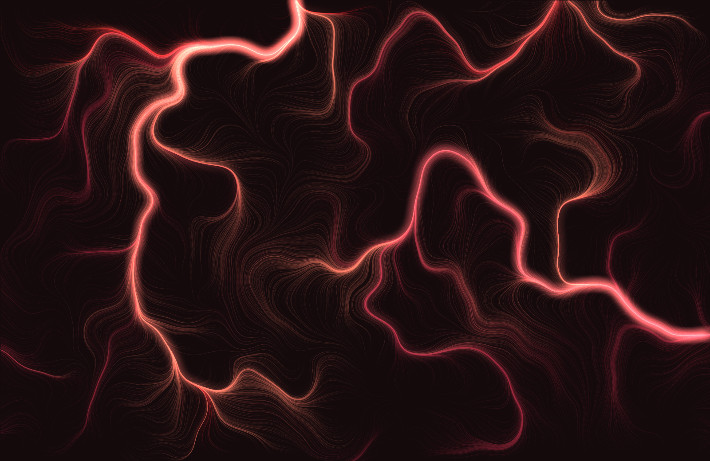
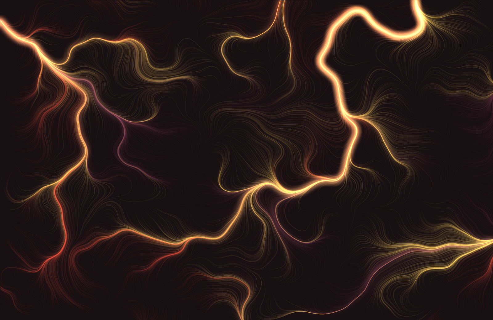
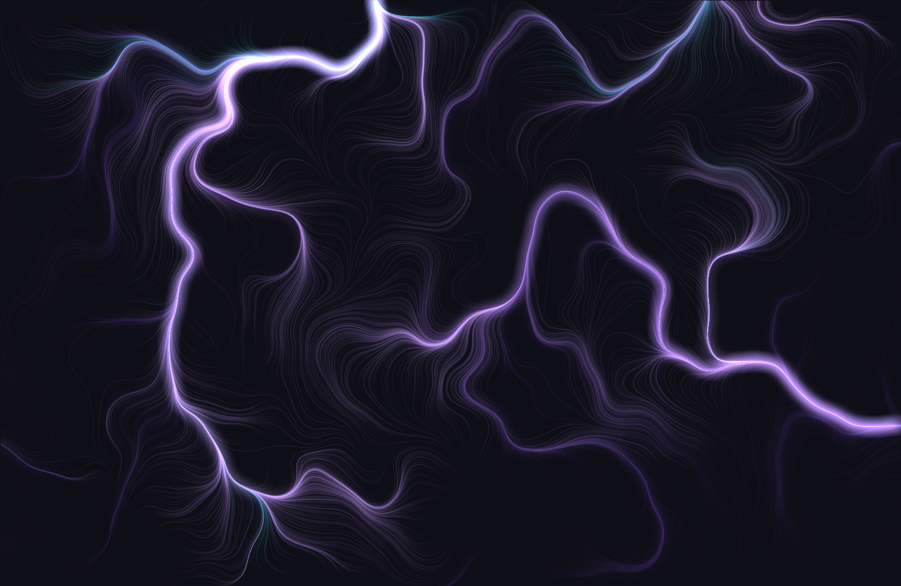

# advect

Generative wallpapers for macOS. Thousands of particles march through a layered
noise field and leave glowing filaments behind them on a near-black ground.
Every render is unique — or pass a seed and get the same picture back.

| | |
|---|---|
|  **harbor** |  **ember** |
|  **moss** |  **dune** |

## Get the app

**[Download Advect.dmg](https://github.com/HyprPixl/advect/releases/latest)** —
drag it to Applications and it lives in your menu bar.

Requires macOS 13 or later. Universal, so it runs natively on both Apple Silicon
and Intel. Signed and notarized, so it opens with a double click. Nothing else
to install: the renderer is compiled into the app, which is 567 KB.

From the menu bar you get:

- **New Wallpaper** — render at your display's native resolution and set it
- **New Day Cycle** — a Dynamic `.heic` whose colour drifts with the time of day
- **Auto-Rotate** — a fresh wallpaper every 30 minutes through once a day
- **Recent** — thumbnails of past renders, click to re-apply, ⌥-click to reveal
- Palette, size and frame-count pickers, and **Launch at Login**

While it paints, a floating panel shows the picture arriving, with a progress bar
and a Cancel button. Wallpapers are set through `NSWorkspace`, so the app never
asks for Automation permission — it needs no permissions at all.

Renders can be triggered from outside too, for a hotkey, a Shortcut or a macro pad:

```
open advect://new
open advect://daycycle
```

## The day cycle

A Dynamic wallpaper packs 32 frames that share one seed, so the geometry is
frozen and only colour and light drift. The result changes continuously through
the day rather than snapping between looks. Every palette is glowing filaments on
a dark ground; only the hue shifts by hour:

| time | palette | colour |
|------|---------|--------|
| night | `harbor` | red |
| dawn / dusk | `ember` | orange |
| morning / midday | `dune` | gold |
| afternoon | `moss` | purple |

`day-cycle.heic` in this repo is a rendered one you can set directly — 32 frames
at 1024×662. Render your own at display resolution from the menu, or with
`advect --dynamic --set`.

## The command line

`advect` is a standalone Python renderer with no dependencies at all — standard
library only, writing real PNGs and macOS Dynamic `.heic` files by hand.

```
advect                    # render to ~/Pictures/advect/, print path
advect --set              # render AND set as desktop wallpaper
advect --palette ember    # harbor | ember | moss | dune
advect --seed 7 --size 2016x1310
advect --sharp 0.7 --glow 0.9 --softness 1.5
advect --dynamic --set    # a Dynamic .heic that shifts with the time of day
advect --out ~/wall.png   # write somewhere other than ~/Pictures/advect/
```

It compiles `advect_accel.c` on demand with `cc` for the hot loop, and falls
back to a pure-Python march when there's no compiler. Same geometry either way.

## How it works

A particle is dropped at a random point and repeatedly asks the noise field which
way to go, leaving a tapered, anti-aliased streak as it travels. Some strokes are
painted sharp, straight into the image; the rest deposit energy into a coarse
light grid that gets blurred and added back as glow. That split is why the
filaments read as *lit* rather than merely drawn.

The app doesn't shell out to the Python — the renderer is ported to Swift, with
the same C march linked in at build time. Keeping the two honest means
reproducing CPython's Mersenne Twister exactly, down to `init_by_array` seeding
and `genrand_res53`, because a seed has to name the same picture from either
one. Output is verified pixel-identical across seeds, sizes, every palette, and
both architectures.

## Building from source

```
./menubar/build.sh --install     # build, install to ~/Applications, launch
./menubar/build.sh --dmg         # sign, notarize and wrap in a .dmg
```

No Xcode project and no package manager — `swiftc` compiles the sources straight
into a hand-laid bundle. Signing needs a Developer ID certificate and a
`notarytool` keychain profile; `build.sh` documents both.

## Licence

MIT. See [LICENSE](LICENSE).
